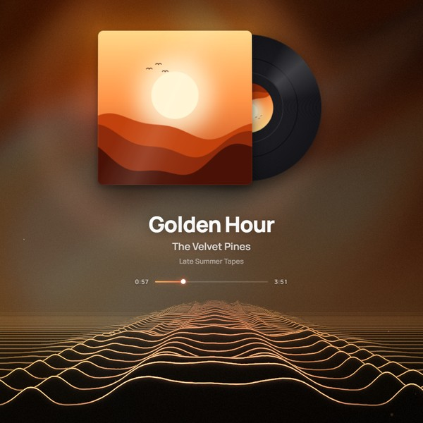

# Resonance

Музыкальные живые обои для [Wallpaper Engine](https://store.steampowered.com/app/431960/). Обложка и название трека берутся из любого плеера (Яндекс Музыка, Spotify, браузер), фон собирается из цветов обложки, звук превращается в визуализацию: «Горизонт», «Горизонт+», «Жидкий свет» и другие.

**Установка:** подпишитесь в Мастерской Steam — ссылка появится здесь после публикации.

## Кнопки на обложке — Resonance Control

Обои умеют ставить трек на паузу и переключать его кликом по обложке, но Wallpaper Engine не даёт обоям управлять плеерами. Это делает маленькая программа-помощник из папки [`control`](control).

- Слушает только `127.0.0.1:57391` и принимает команды только от Wallpaper Engine и Lively.
- Управляет тем плеером, чей трек показан на обоях (через системный медиа-API Windows).
- В интернет не ходит. Весь код — в [`control/ResonanceControl.cs`](control/ResonanceControl.cs).

**Установить:** скачайте репозиторий (Code → Download ZIP), распакуйте и запустите `control\install.cmd`. Скрипт соберёт программу из исходников встроенным компилятором .NET и добавит её в автозагрузку.
**Удалить:** `control\uninstall.cmd`.

## Конфиденциальность

Настройка «Чёткие обложки» отправляет название трека и исполнителя в Deezer и iTunes, чтобы найти обложку побольше. Больше ничего никуда не отправляется. Настройку можно выключить.

## Поддержать автора

Обои бесплатные. Если хотите сказать спасибо — USDT в любой из сетей ниже.
**Отправляйте только USDT и только в той сети, что указана рядом с адресом** — другие монеты или другая сеть могут потеряться.

| Сеть | Адрес USDT |
|---|---|
| TON | `UQDn8njNDzVExiHLLDgigNTtiWAZ6J4us8rT3VZ1qhxCzTcw` |
| Tron (TRC20) | `TGEQEUstJFwC3oHDedYxwxtgP8ZpX5PFWk` |
| BNB Smart Chain (BEP20) | `0x1C69A0DCACe8D205B462A18beB6Ac1952660C337` |
| Solana | `HkUg3AD14sa6y4n9PjmkovTQwnEbrmM6QcEFkW2cY6zm` |
| Ethereum (ERC20) | `0x1C69A0DCACe8D205B462A18beB6Ac1952660C337` |

## Лицензия

Код — MIT ([LICENSE](LICENSE)). Шрифты — SIL Open Font License ([fonts/OFL.txt](fonts/OFL.txt)). Сторонние компоненты — [THIRD-PARTY.txt](THIRD-PARTY.txt).

---

# Resonance (English)

Music live wallpaper for [Wallpaper Engine](https://store.steampowered.com/app/431960/). Cover and track info come from any player (Spotify, browsers, Yandex Music), the background is made from the cover colors, and the audio drives the visualizers: Horizon, Horizon+, Liquid light and more.

**Install:** subscribe on the Steam Workshop — the link will appear here after publishing.

**Cover buttons (Resonance Control):** Wallpaper Engine does not let wallpapers control players, so a tiny helper in [`control`](control) does it. It listens on `127.0.0.1:57391` only, accepts commands only from Wallpaper Engine and Lively, controls the player whose track is shown, and never goes online. Install: download the repo, run `control\install.cmd` (builds from source with the built-in .NET compiler and adds itself to startup). Uninstall: `control\uninstall.cmd`.

**Privacy:** the "Sharp covers" setting sends the track title and artist to Deezer and iTunes to find a larger cover. Nothing else is sent. You can turn it off.

**Support the author:** the wallpaper is free. To say thanks, send USDT using one of the networks in the table above. **Send only USDT and only on the network listed next to the address** — other coins or another network may be lost.

**License:** code — MIT, fonts — SIL OFL 1.1, third-party notices — THIRD-PARTY.txt.
